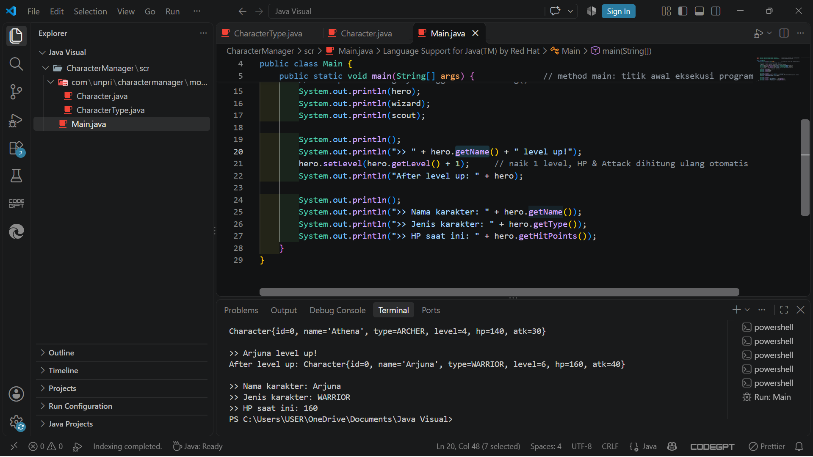
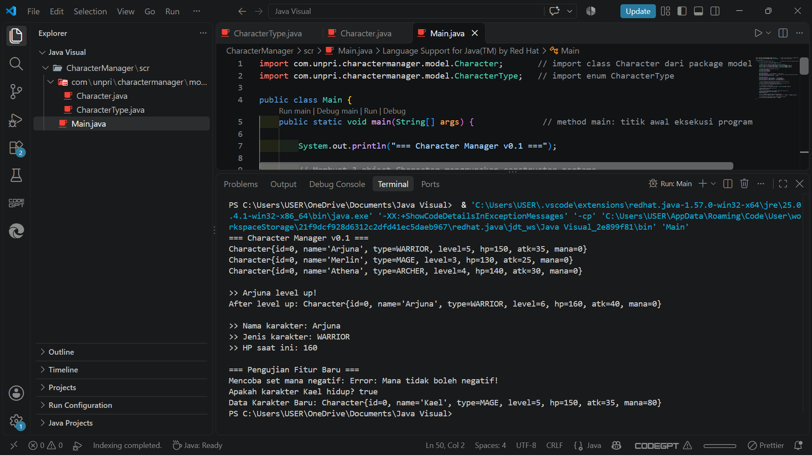

# Character Manager — TP3 (Java Visual SIH-6406)

Aplikasi ini adalah sistem manajemen karakter sederhana berbasis teks (Console-based Game Character Manager) yang dibangun menggunakan bahasa pemrograman Java. Proyek ini menerapkan prinsip Pemrograman Berorientasi Objek (OOP), khususnya enkapsulasi (Encapsulation) dengan pembatasan hak akses atribut menggunakan setter, getter, serta fungsi validasi nilai logika. Sistem juga mendukung kalkulasi otomatis status karakter (HP dan Attack) berdasarkan level serta fitur pelacakan kondisi hidup/mati karakter.

## Screenshot Output Terminal

Berikut adalah hasil eksekusi program di terminal setelah menambahkan fitur pengecekan status `isAlive()` dan atribut `mana`:





## Struktur Folder Project

```text
CharacterManager/
├── src/
│   ├── Main.java
│   └── com/
│       └── unpri/
│           └── charactermanager/
│               └── model/
│                   ├── Character.java
│                   └── CharacterType.java
└── img
│   ├── output.png
│   └── output2.png
└── README.md
```

## Identitas Mahasiswa

* Nama Lengkap: Yugas Bintang Bimantara harefa
* NIM: 253303621229
* Link Google Docs: https://docs.google.com/document/d/13VmEHhD6g9jfoNQVd79ebY7AujzoQrAAqYsLhu1JZDE/edit?usp=sharing